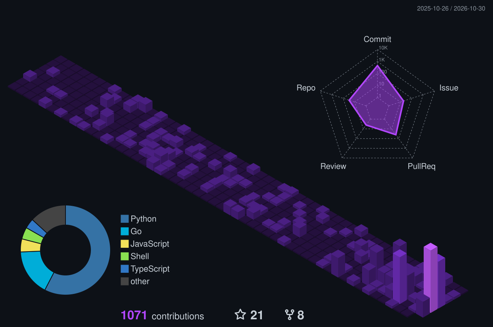

<h1 align="center">Hi 👋, I'm Akshaj Tiwari</h1>

<strong>Student developer · Machine learning &amp; useful software</strong>

  <a href="https://akshaj-portfolio.vercel.app">Portfolio</a> ·
  <a href="https://www.linkedin.com/in/akshaj-tiwari/">LinkedIn</a> ·
  <a href="mailto:akshajtiwari@hotmail.com">Email</a>

  I build practical tools and explore machine learning, data analysis, and developer experience.

<table align="center">
  <tr>
    <td align="center" width="50%">
       
      AI as a tool for learning in VS Code.
    </td>
    <td align="center" width="50%">
       
      Track applications and manage documents.
    </td>
  </tr>
</table>

  
  

  

  <a href="#featured-projects">Projects</a> ·
  <a href="#tech-stack">Tech Stack</a> ·
  <a href="#connect">Connect</a>

## 🎨 Featured Projects

| Project | What it does |
| --- | --- |
| [Sensei](https://github.com/akshajtiwari/Sensei) | A VS Code extension that uses AI as a learning tool. |
| [PaperTrail](https://github.com/akshajtiwari/PaperTrail) | A job application tracker and document manager. |
| [Akshara ULPF](https://github.com/akshajtiwari/akshara-ulpf) | A universal log preprocessing framework. |
| [WiFi Agent](https://github.com/akshajtiwari/Wifi-Agent) | Keeps captive portal connections authenticated across platforms. |

## 🛠️ Tech Stack

  

  

<!-- <h3 align="center">📈 3D Contribution Calendar</h3> -->

  

## 🌐 Connect With Me

  
  
  
  

  

